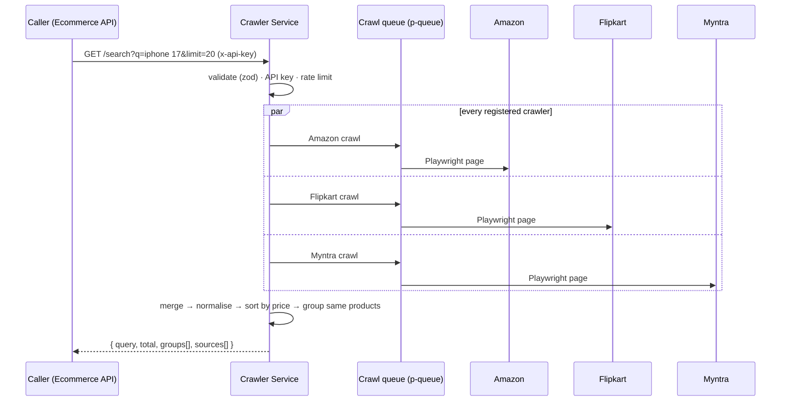

# Crawler Service

[](https://github.com/Lucifer180/Crawler-service/actions/workflows/deploy.yml)


A price-comparison crawler for Indian online stores. One search request fans out to **Amazon, Flipkart and Myntra** in parallel with headless Chromium, normalises the listings, works out which listings are **the same product across stores**, and returns grouped offers sorted by price.

It runs as an internal microservice on Google Cloud Run, called by the [Ecommerce API](https://github.com/Lucifer180/Ecommerce-node-js).

---

## Contents

- [User stories](#user-stories)
- [How a search works](#how-a-search-works)
- [Cross-store product matching](#cross-store-product-matching)
- [Reliability and load control](#reliability-and-load-control)
- [API](#api)
- [Configuration](#configuration)
- [Running locally](#running-locally)
- [Tests](#tests)
- [Deployment](#deployment)
- [Project structure](#project-structure)

---

## User stories

| ID | As a… | I want to… | So that… | Acceptance criteria |
|----|-------|-----------|----------|---------------------|
| CS-01 | shopper (via the store front end) | search one query across Amazon, Flipkart and Myntra | I can compare prices without opening three sites | `GET /search?q=` returns results from every store that answered, sorted cheapest first |
| CS-02 | shopper | see one entry per product with an offer from each store | I can spot the cheapest store at a glance | Listings of the same product are grouped. Each group has one offer per store: the cheapest one. |
| CS-03 | shopper | never be shown a "lowest price" for a different product | I can trust the comparison | Matching requires brand, model, variant words (Pro, Max, FE…) and storage to agree. Doubtful pairs are kept apart. |
| CS-04 | shopper | still get results when one store is down or blocks the crawler | one bad store doesn't ruin the search | A failing store is retried once, then reported in `sources[]` with `status: "failed"`, while the other stores' results are still returned |
| CS-05 | shopper | open a product's full details (images, sizes, colours, specs) | I can decide before buying | `POST /details {platform, url}` returns parsed details. Repeat requests come from a 15-minute cache. |
| CS-06 | API owner | only let trusted callers trigger crawls | strangers can't burn browser sessions | Crawl routes require `x-api-key`, compared in constant time. In production, an empty key list rejects every request instead of leaving the service open. |
| CS-07 | API owner | stop a single client from flooding the service | capacity is shared fairly | 30 requests per minute per API key (or IP), returning `429` with standard rate-limit headers |
| CS-08 | operator | shed load instead of queueing forever when busy | latency stays bounded | At most `MAX_CONCURRENT_SESSIONS` browsers run at once. Past `MAX_QUEUE_DEPTH` waiting crawls, callers get `503`. |
| CS-09 | operator | not let the service fetch arbitrary URLs | it can't be turned into an open proxy (SSRF) | `/details` only accepts http(s) URLs on that store's own domains, with credentials and fragments removed |
| CS-10 | operator | know whether an instance can actually crawl | the load balancer only sends traffic to healthy instances | `/health/ready` returns `503` when Chromium is disconnected. `/health/live` is a cheap liveness probe. |
| CS-11 | developer | find out when a store changes its HTML before users do | broken selectors get fixed quickly | `scripts/canary.ts` searches each live store and fails if fewer than 5 results come back or more than 20% are missing prices |

---

## How a search works



The search pipeline (`src/orchestrator/search.orchestrator.ts`):

1. **Fan out**: every crawler in the registry runs in parallel, each wrapped in `withRetry` (2 attempts).
2. **Isolate failures**: a store that throws becomes a `failed` source report instead of failing the request.
3. **Merge and process**: listings are merged, normalised (`ProductProcessor`) and sorted by price (`SortService`).
4. **Group**: `ProductGroupingService` clusters listings that are the same product. Each group lists one offer per store, cheapest first.
5. **Respond** with the first `limit` groups and a per-store report (status, count, duration, error).

### Response shape

```json
{
  "query": "iphone 17",
  "total": 14,
  "groups": [
    {
      "id": "3f1c…",
      "title": "Apple iPhone 17 (Black, 256 GB)",
      "brand": "Apple",
      "image": "https://…",
      "offers": [
        { "platform": "flipkart", "price": 79900, "url": "https://…", "image": "https://…" },
        { "platform": "amazon",   "price": 82900, "url": "https://…", "image": "https://…" }
      ]
    }
  ],
  "sources": [
    { "platform": "amazon",   "status": "ok",     "count": 24, "durationMs": 8123 },
    { "platform": "flipkart", "status": "ok",     "count": 20, "durationMs": 6410 },
    { "platform": "myntra",   "status": "failed", "count": 0,  "durationMs": 30012, "error": "Timeout" }
  ]
}
```

---

## Cross-store product matching

Stores name the same product very differently:

| Store | Title |
|-------|-------|
| Flipkart | `Apple iPhone 17 (Black, 256 GB)` |
| Amazon | `Apple iPhone 17 256 GB: 15.93 cm (6.3″) Display with …` |
| Myntra | `OnePlus Nord 3r TWS Earbuds` (drops "Buds") |
| Amazon | `OnePlus Nord Buds 3r TWS Earbuds up to 54 Hours Playback, …` |

Plain string similarity misses real matches and makes false ones ("CASE CREATION Galaxy S25 Case" vs "Samsung Galaxy S25"). So `src/matching/ProductMatcher.ts` reduces each title to the parts that identify a product, and every part must agree:

- **Brand**, from the listing or the first title word.
- **Model tokens**: digit-bearing tokens and variant words (`s25`, `plus`, `pro`, `fe`, `ultra`…). "S25" and "S25 FE" are different products.
- **Name words**: the product's own name, between the brand and the first category word.
- **Storage**: the largest GB figure (storage, not RAM).
- **Attributes**: non-numeric words inside brackets, which in practice is the colour.

Spec tokens (`13mm`, `5000mah`, `12gb`), years and store SKU codes are ignored. Grouping uses **complete linkage**: a listing joins a group only if it matches *every* member, so one loose match can't chain unrelated products together. Every rule leans towards **not** merging, because a wrong merge shows someone a "lowest price" for a different product.

---

## Reliability and load control

| Concern | How it's handled |
|---------|------------------|
| Browser cost | One shared Chromium (`BrowserManager`). Each crawl gets its own browser context, which is always closed in `finally` (`withSession`). |
| Concurrency | `p-queue` caps running sessions (`MAX_CONCURRENT_SESSIONS`, default 3) and kills a crawl after `CRAWL_TIMEOUT_MS` (90 s) |
| Backpressure | When the queue holds `MAX_QUEUE_DEPTH` (20) waiting jobs, new calls get `503 TooBusy` straight away |
| Flaky sites | `withRetry` gives each store 2 attempts. A failed store is reported, not fatal. |
| Repeat lookups | Product details are cached in an in-memory LRU with expiry (`CACHE_TTL_MS` 15 min, `CACHE_MAX_ENTRIES` 500) |
| Bot protection | Full Chromium headless channel (Myntra resets the stripped headless shell), `navigator.webdriver` hidden, realistic user agent, optional blocking of heavy resources |
| Containers | `--no-sandbox` and `--disable-dev-shm-usage` (Docker's 64 MB `/dev/shm` crashes tabs). `dumb-init` reaps Chromium's zombie processes. |
| Shutdown | SIGTERM/SIGINT stop accepting requests, close the browser, and force-exit after 8 s |
| Logs | Structured `pino` logs with a per-request logger (`req.log`) |
| Config | Every environment variable is validated with zod at boot. Bad config exits with a clear list of problems. |

---

## API

All routes except `/health*` need `x-api-key: <key>` (see `API_KEYS`).

| Method | Path | Description |
|--------|------|-------------|
| GET | `/search?q=<query>&limit=<1-50>` | Cross-store search. `q` is 2–120 characters, `limit` defaults to 20. |
| POST | `/details` | Body `{ "platform": "amazon" \| "flipkart" \| "myntra", "url": "<product page>" }`. Parsed product details, cached. |
| GET | `/health` | `{ status: "ok" }` |
| GET | `/health/live` | Liveness with uptime |
| GET | `/health/ready` | `200 ready` when Chromium is connected, `503 degraded` otherwise |

**Errors** are JSON `{ error: { code, message, details?, requestId } }`: `400` validation, `401` missing or wrong API key, `429` rate limited, `503` too busy, `404` unknown route.

```bash
curl -H "x-api-key: $KEY" "http://localhost:5000/search?q=nike%20running%20shoes&limit=10"

curl -X POST -H "x-api-key: $KEY" -H "Content-Type: application/json" \
     -d '{"platform":"flipkart","url":"https://www.flipkart.com/…"}' \
     http://localhost:5000/details
```

---

## Configuration

Set these in `.env` (all have defaults except `API_KEYS` in production).

| Variable | Default | Purpose |
|----------|---------|---------|
| `NODE_ENV` | `development` | In `production`, requests are rejected unless `API_KEYS` is set |
| `PORT` | `5000` (Docker: `8080`) | HTTP port |
| `API_KEYS` | empty | Comma-separated allowed keys. Empty disables the check outside production. |
| `CORS_ORIGINS` | `*` | Allowed browser origins (currently forced to `*` in `src/config/index.ts`) |
| `HEADLESS` | `true` | Run Chromium headless |
| `NAV_TIMEOUT_MS` | `30000` | Page navigation timeout |
| `MAX_CONCURRENT_SESSIONS` | `3` | Browser sessions running at once |
| `MAX_QUEUE_DEPTH` | `20` | Waiting crawls before returning `503` |
| `CRAWL_TIMEOUT_MS` | `90000` | Watchdog for one crawl |
| `BLOCK_HEAVY_RESOURCES` | `true` | Skip images, fonts and media while crawling |
| `CACHE_TTL_MS` | `900000` | Details cache lifetime (15 min) |
| `CACHE_MAX_ENTRIES` | `500` | Details cache size |
| `LOG_LEVEL` | `info` | pino level |

---

## Running locally

```bash
npm install
npx playwright install chromium
# create .env with the variables from the Configuration table, e.g. API_KEYS=dev-key
npm run dev                 # ts-node-dev with reload, http://localhost:5000
```

With Docker (the image ships its own browsers):

```bash
docker build -t crawler-service .
docker run --rm -p 8080:8080 -e API_KEYS=dev-key crawler-service
```

The runtime image tag (`mcr.microsoft.com/playwright:v1.62.1-noble`) **must match** the installed `playwright` version, or Chromium fails to launch.

---

## Tests

```bash
npm test            # vitest
npm run typecheck   # tsc --noEmit
```

| Suite | Covers |
|-------|--------|
| `unit/matching.test.ts` | Same-product decisions across real store title formats |
| `unit/grouping.test.ts` | Complete-linkage grouping and one cheapest offer per store |
| `unit/memoryCache.test.ts` | TTL and size eviction |
| `unit/withSession.test.ts` | Contexts are always closed, and the queue limit is enforced |
| `helpers/flipkartDetails.test.ts` | Flipkart product-page parser against a saved HTML fixture |
| `http/search.test.ts` | The HTTP layer: validation, API key, error shapes (supertest) |

**Canary** (live sites, run on a schedule, not on every push):

```bash
npx ts-node scripts/canary.ts
```

---

## Deployment

GitHub Actions (`.github/workflows/deploy.yml`):

1. **test**, on every push and PR: `npm ci`, install Chromium, typecheck, vitest.
2. **deploy**, on `main` only, after tests pass:
   - Authenticates to Google Cloud with **Workload Identity Federation** (no stored service-account keys)
   - Builds the image and pushes it to **Artifact Registry** (`asia-south1`)
   - Deploys to **Cloud Run**: 2 vCPU / 2 GiB, concurrency 4, 0–5 instances, 300 s timeout
   - `API_KEYS` comes from **Secret Manager** (`crawler-api-keys`)

Required repository secrets: `WIF_PROVIDER`, `WIF_SERVICE_ACCOUNT`.

---

## Project structure

```
src/
├── server.ts                 # boot: Chromium, HTTP server, graceful shutdown
├── app.ts                    # express: CORS, request context, API key, rate limit, routes
├── config/                   # zod-validated environment
├── routes/                   # /search, /details, /health
├── controllers/
├── orchestrator/             # parallel fan-out across stores
├── crawlers/
│   ├── BaseCrawler.ts        # crawler contract
│   ├── base/BaseFetcher.ts
│   ├── amazon/ flipkart/ myntra/   # fetcher · parser · selectors · details parser
├── registry/                 # which crawlers are active
├── matching/ProductMatcher.ts
├── services/                 # merge, grouping, sort, product details
├── processors/ normalizers/
├── browser/                  # BrowserManager, withSession
├── queue/                    # p-queue with backpressure
├── cache/                    # in-memory TTL cache
├── middleware/               # apiKey, rateLimit, requestContext, errorHandler
├── validators/               # zod schemas, URL allow-list
├── utils/                    # logger, retry, SingleFlight
└── tests/
scripts/canary.ts             # live-site health probe
Dockerfile                    # build stage + Playwright runtime
```

---

## Responsible use

This service reads public listing pages for personal price comparison. Keep request volume low (the queue and rate limits exist for this), respect each site's terms of service and robots rules, and don't redistribute scraped content.
